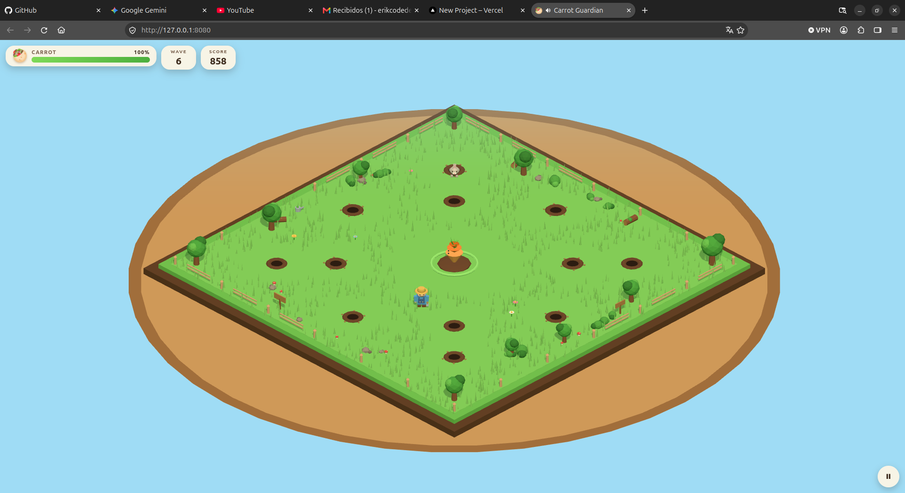

<div align="center">

# 🥕 Carrot Guardian

**A cozy isometric survival game about saving one very important carrot.**

Close the rabbit holes, bonk the bunnies, grab the power-ups, and survive as many
waves as you can. Built with plain HTML, CSS, vanilla JavaScript and Three.js —
no framework, no build step, no backend.

[](https://carrotguardian.vercel.app/)
[](https://threejs.org)
[](https://developer.mozilla.org/docs/Web/JavaScript)
[](#-getting-started)

<!-- Replace the placeholder URL below with your hosted game link. -->
<!-- Also drop your screenshot at assets/screenshots/gameplay.png -->

[](https://your-game-url.example)

</div>

---

## ▶ Play now

**👉 [Play Carrot Guardian in your browser]([https://your-game-url.example](https://carrotguardian.vercel.app/)) 👈**

Runs on desktop and mobile. Landscape is the preferred orientation on phones.
No download, no account, nothing to install.

> Want to run it locally? See [Getting started](#-getting-started).

---

## 🌱 What is this?

You are a tiny gardener standing on a miniature grass diorama. Rabbit holes pop
open around the field, cute rabbits wander out and march straight for the carrot
in the middle. Your job is simple to understand and hard to master:

1. **Close the holes** before more rabbits crawl out.
2. **Bonk the rabbits** that are already loose.
3. **Protect the carrot** — it only has 100 health.
4. **Collect power-ups** and keep going as the waves get faster.

If the carrot hits zero, the run is over. That's it. Cozy, readable, a little
arcade-y.

---

## ✨ Features

- **Isometric diorama** rendered with an `OrthographicCamera` and warm, soft
  lighting.
- **Fully procedural low-poly art** — every model, from the gardener to the
  carrot, is generated from primitives at load time. No binary art to go missing.
- **Zero frameworks** — plain ES modules and Three.js r160 (vendored, no CDN
  required).
- **Desktop and mobile from day one** — keyboard, mouse, and a thumb-friendly
  virtual joystick with contextual action buttons.
- **Gamepad-free, grid-free movement** — smooth, camera-relative steering.
- **Waves that escalate** — more rabbits, more holes, faster spawns, but never
  all at once.
- **Temporary power-ups** — Speed, Power and Range, each with a draining timer in
  the HUD.
- **Juicy feedback everywhere** — hole dust, hit flashes, knockback, particles,
  synthesized sound effects and floating text.
- **Auto-pause on tab blur** so you never come back to a chewed carrot.
- **Saves your best wave and score** to `localStorage`.
- **Automatic quality scaling** based on device capabilities.

---

## 🎮 Controls

| Action | Desktop | Mobile |
| --- | --- | --- |
| Move | `W` `A` `S` `D` or arrow keys | Left thumb joystick |
| Attack | `Space`, `J`, `Enter`, or left click | ⚔ button (right side) |
| Close hole / interact | `E`, `K`, `F`, or right click | 🕳 button (right side) |
| Pause | `Escape` or `P` | ❙❙ button (top right) |

Movement is camera-relative, so **"up" always means "away from the camera"**. On
touch, the left half of the screen *is* the joystick wherever you press it — no
fixed pad to hunt for. Action buttons only light up when a rabbit or an open hole
is actually in range, so you never wonder whether a tap did anything.

---

## 🔁 How it plays

```text
        START WAVE
             ↓
        HOLES OPEN
             ↓
       RABBITS SPAWN
             ↓
       RABBITS MOVE
             ↓
           CARROT
             ↑
      PLAYER DEFENDS
        ↙          ↘
   CLOSE HOLES    ATTACK
        ↓            ↓
      REWARD       REWARD
        ↘            ↙
         POWER-UPS
             ↓
       NEXT WAVE (harder)
```

A rabbit that reaches the carrot nibbles it every 1.1 s for 5 damage. Closing a
hole seals it for 6.5 s and gives you breathing room. Clear a wave for **+100**
and a small carrot top-up, then the next wave opens more holes and moves faster.

### Scoring

| Event | Score |
| --- | --- |
| Rabbit defeated | +10 |
| Hole closed | +5 |
| Power-up collected | +2 |
| Wave cleared | +100 |

### Power-ups

All temporary, which keeps the moment-to-moment decisions interesting.

| Pickup | Effect | Duration |
| --- | --- | --- |
| ⚡ SPEED | +30% movement speed | 10 s |
| ⚔ POWER | +1 attack damage | 10 s |
| 🎯 RANGE | +0.9 attack reach | 12 s |

Active buffs show up as chips along the bottom of the HUD with a draining timer.

---

## 🚀 Getting started

ES modules and GLB assets need a real HTTP origin, so open the game through a
local server instead of double-clicking `index.html`:

```bash
python3 -m http.server 8000
```

Then open <http://localhost:8000>.

Any static server works (`npx serve`, `php -S`, nginx…). **There is nothing to
install and nothing to compile.**

---

## 🛠 Tech stack

| Layer | Choice |
| --- | --- |
| Rendering | [Three.js](https://threejs.org) r160 (vendored) |
| Language | Vanilla JavaScript, ES modules |
| Styling | Hand-written CSS with design tokens |
| Art | Procedural low-poly geometry, Kenney-style palette |
| Audio | Synthesized with the Web Audio API |
| Persistence | `localStorage` |
| Build tooling | None |

No React, no Vue, no bundler, no backend.

---

## 📁 Project layout

```text
cozy-rabbit/
├── index.html          Import map + all UI markup
├── AGENTS.md           Design and technical specification
├── css/
│   ├── main.css        Reset, tokens, screens, shared controls
│   ├── menu.css        Main menu, options panel, game over
│   └── game.css        HUD, wave banner, hints, touch controls
├── js/
│   ├── main.js         Bootstraps Game and reports fatal errors
│   ├── core/           Game, GameState, Config, Input, Assets, Audio, Save
│   ├── world/          World, Board, Hole, Carrot
│   ├── entities/       Player, Rabbit, PowerUp
│   ├── systems/        Waves, Spawning, Combat, Power-ups, Particles
│   ├── camera/         IsometricCamera (OrthographicCamera)
│   ├── models/         Procedural low-poly geometry, palette, cache
│   ├── ui/             HUD, MainMenu, GameOverScreen, TouchControls
│   └── utils/          Math helpers, object pool
├── assets/
│   ├── models/         manifest.json (optional external GLB overrides)
│   └── screenshots/    Gameplay screenshots for the README
└── vendor/three/       Three.js r160 + loaders (vendored, no CDN needed)
```

### Architecture conventions

- **One loop.** `Game._loop` is the only animation loop. It clamps delta time to
  50 ms and calls `update(dt)` then `render()`.
- **One config.** Every gameplay number lives in `js/core/Config.js`. No magic
  numbers in gameplay code.
- **Ground is Y = 0.** Entities rest above it. X is horizontal, Z is depth.
- **One input abstraction.** `Player` asks `InputManager` for a movement vector
  and button states — it never knows whether input came from a keyboard, a mouse
  or a thumb.
- **Pooling.** Rabbits and particles come from pools, so combat never churns
  through garbage.

### Swapping in real models

Everything is procedural by default, but you can point a key in
`assets/models/manifest.json` at a GLB:

```json
{
  "models": {
    "player": "assets/models/player.glb",
    "rabbit": "assets/models/rabbit.glb"
  }
}
```

Every key defaults to `null`, which means "use the procedural version". Loaded
models are normalised for scale, origin and Y-up orientation. A failed load logs
a warning and falls back to the procedural model instead of breaking the game.

---

## ⚙️ Settings and saved data

Options live in the main menu and persist to `localStorage` under
`carrot-guardian-save-v1`:

- Music on / off
- Sound effects on / off
- Force touch controls on / off
- Shadows on / off
- Quality preset (auto / high / low)

Your best wave and best score are stored in the same place and shown on the menu
and on the game over screen.

---

## ⚡ Performance

Quality is picked automatically from `hardwareConcurrency` and `deviceMemory`.
Low-core touch devices start on the low preset (smaller shadow map, fewer grass
blades, fewer particles, capped pixel ratio, shadows off). On a typical desktop
run the scene stays around **300–350 draw calls** and **~33k triangles**.

---

## 🌍 Browser support

Modern Chrome, Firefox, Safari and Edge. ES modules, WebGL2 and the Web Audio API
are the only requirements.

---

## 📜 License

Personal project. Kenney-style low-poly art direction, original code.
